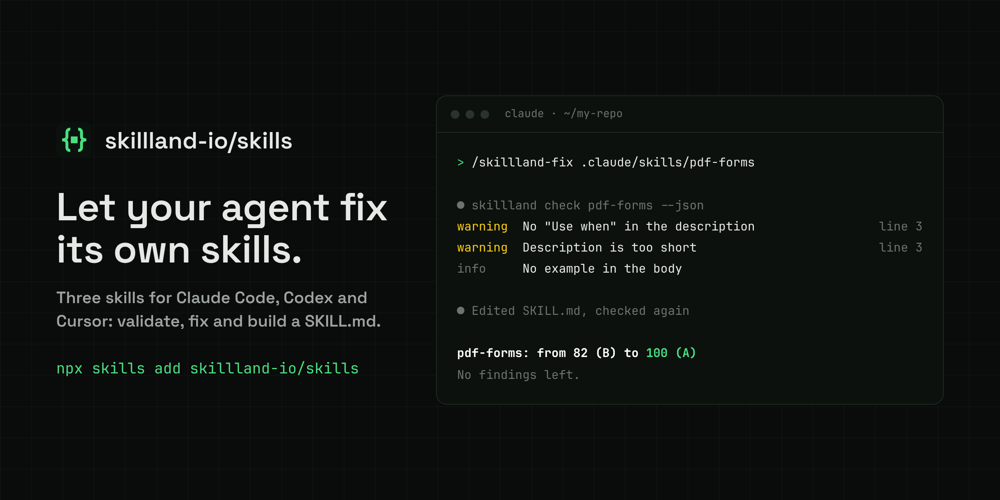

# Skillland skills

[](https://github.com/skillland-io/skills/actions/workflows/ci.yml)
[](https://www.npmjs.com/package/@skillland/validator)
[](LICENSE)

Website: **[skillland.io/tools/skills](https://skillland.io/tools/skills)**. Install steps, what each skill does and a sample fix run.



Three agent skills for Claude Code, Codex and Cursor that build, check and fix other skills with the [Skillland validator](https://github.com/skillland-io/skill-validator). Each validator rule quotes the official guidance it relies on: the [Agent Skills specification](https://agentskills.io/specification) and the skills docs from Anthropic, OpenAI and Cursor.

| Skill | What it does | Starts on its own |
| --- | --- | --- |
| [`skillland-validate`](skills/skillland-validate/SKILL.md) | Runs the validator on a skill and reports the score, the grade and each finding with its rule page. Changes no files. | Yes, when you ask to check or review a skill |
| [`skillland-fix`](skills/skillland-fix/SKILL.md) | Edits a skill and re-checks it until it scores A. | No, call it by name |
| [`skillland-build`](skills/skillland-build/SKILL.md) | Asks the questions of the [skill builder](https://skillland.io/validate/builder), writes the folder where your agent loads skills, then checks it. | When you ask to build a skill with Skillland |

The skills hold no copy of the rules. Each one runs `npx -y -p @skillland/validator@latest skillland check`, so a new rule reaches them with the next validator release. They need Node 20 or later.

## Install

As a Claude Code plugin, all three skills at once:

```text
/plugin marketplace add skillland-io/skills
/plugin install skillland@skillland
```

On Claude Code 2.1.275 or later one line does both: `/plugin install skillland --marketplace skillland-io/skills`. In a plugin the skills take the plugin name as a prefix, so `skillland-fix` runs as `/skillland:skillland-fix`.

With the [skills CLI](https://github.com/vercel-labs/skills), for Claude Code, Codex or Cursor:

```bash
npx skills add skillland-io/skills
```

Or copy a folder from `skills/` to where your agent looks for skills:

| Agent | Project | Personal |
| --- | --- | --- |
| Claude Code | `.claude/skills/` | `~/.claude/skills/` |
| Codex | `.agents/skills/` | `~/.agents/skills/` |
| Cursor | `.cursor/skills/` or `.agents/skills/` | `~/.cursor/skills/` |

## Use

- "Check my pdf-forms skill" loads `skillland-validate`.
- `/skillland-fix` in Claude Code (`/skillland:skillland-fix` from the plugin) and Cursor, or `$skillland-fix` in Codex, fixes what it found.
- "Build a skill with Skillland that writes release notes" loads `skillland-build`.

A grade measures structure against the official guidance. It doesn't tell you whether a skill does its job well, so try it on a real task too.

## Checks on this repo

CI runs the validator on every skill here and fails below 90, so each one stays at A:

```bash
npx -y -p @skillland/validator@latest skillland check skills --min-score 90
```

It also runs `claude plugin validate --strict .` on the plugin and marketplace files in `.claude-plugin/`. Bump `version` in `plugin.json` when a skill changes, since Claude Code offers plugin updates by version.

## Related

- [skill-validator](https://github.com/skillland-io/skill-validator): the rules and scoring these skills run, published as [`@skillland/validator`](https://www.npmjs.com/package/@skillland/validator).
- [skillland.io/validate](https://skillland.io/validate): the same checks in the browser, with a page for [every rule](https://skillland.io/validate/rules).
- [skillland.io/skills](https://skillland.io/skills): the most installed public skills, each with its score and report.

Found a rule that reads the guidance wrong? [Open an issue on the validator](https://github.com/skillland-io/skill-validator/issues) with a link to the source.

## License

MIT
